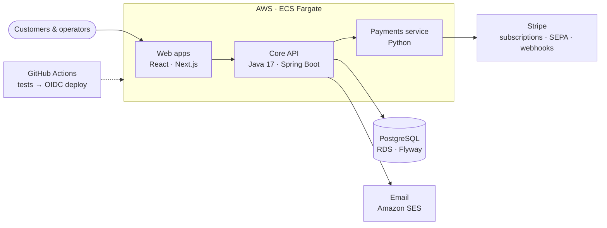

  

<h3 align="center">Founder @ BeWorking &amp; Globaltechno OÜ · Building <a href="https://globaltechno.io">maarja.ai</a>, an AI agent that runs a company's operations</h3>

  
  
  
  

---

### 👋 About me

I build software and run the businesses it serves.

I spent the first part of my career on the operating side: **8 years running operations for a 15-hotel group (€17M turnover)**, then founding **WebRentals**, a B2B distribution platform for short rentals, and **manaager.com**, a channel manager for holiday rentals that I sold in 2023.

Today I design, build and operate **[BeWorking](https://be-working.com)**, a multi-tenant SaaS for coworking spaces running in production on AWS, and I'm building **maarja.ai** at **[Globaltechno OÜ](https://globaltechno.io)**. Currently studying Computer Science at IU International University.

---

### 🚀 What I'm building

| | |
|---|---|
| ◎ **maarja.ai** · *early access* | An AI agent that runs a company's daily operations in the tools it already uses, with a human in charge of what matters. Every action is logged; payments wait for a human yes. |
| ⛨ **gtID** · *in development* | The delegation layer under Maarja: each process has an authority level (D0–D4), starting at suggest-only and climbing only on evidence. |
| ▣ **BeWorking** · *live* | Coworking and virtual office in Málaga, on a platform I designed and build. Maarja's first company. |

#### BeWorking platform

- **Billing:** Stripe subscriptions, SEPA debits, invoices and credit notes, daily payment reconciliation
- **Compliance:** EU VAT rules per customer type, accounting sync
- **Access:** building door keys tied to active subscriptions
- **Delivery:** six services on ECS Fargate, test-gated CI/CD, least-privilege deploys

---

### 🧭 Career

| Years | Role |
|---|---|
| 2020 – today | **Founder**, BeWorking (Málaga) · **Founder**, Globaltechno OÜ (Tallinn) |
| 2018 – 2023 | **Founder**, manaager.com: channel manager for holiday rentals in Spain, *sold in 2023* |
| 2012 – 2018 | **Founder**, WebRentals: B2B distribution for short rentals |
| 2004 – 2012 | **Operations Manager**, MF Turiscontrol (Grupo Summa Hoteles): 15 hotels, €17M turnover |

---

### 🧰 Tech stack

---

### 📫 Let's talk

Reach me on **[LinkedIn](https://www.linkedin.com/in/jose-am-talavera-5346391/)** or through **[globaltechno.io](https://globaltechno.io)**.
